<div align="center">

<a href="https://github.com/subin21cc/github-readme-cat">
<picture>
  <source media="(prefers-color-scheme: dark)" srcset="./github-readme-cat/cat-dark.svg">
  
</picture>
</a>

<br/>

# `Tavleen_kaur`


<br/>

[](https://linkedin.com/in/tavleen-kaur-9296b7313)
[](https://github.com/tavleen2008)
[](mailto:tavleenk4280@gmail.com)
[](https://leetcode.com/itsmetavleen)

</div>

---

### `> whoami`

```yaml
name: Tavleen Kaur
role: Full Stack Developer
education: B.Tech Computer Science @ Thapar University

interests:
  - Data Structures & Algorithms
  - Backend Engineering
  - System Design
  - Scalable Web Applications

currently: Learning, building, and solving problems
```

### `> tech_stack`

<div align="center">


</div>

### `> what_i_do`

```text
[01] Build dynamic, responsive full-stack applications
[02] Design REST APIs and backend systems
[03] Solve DSA problems and explore algorithms
[04] Learn by engineering systems that challenge me
```


<div align="center">

💬 Open to collaborations, interesting projects, and conversations about full-stack development, DSA, and backend engineering.

<br/>


```cpp
while (alive) { learn(); build(); solve(); }
```


</div>
